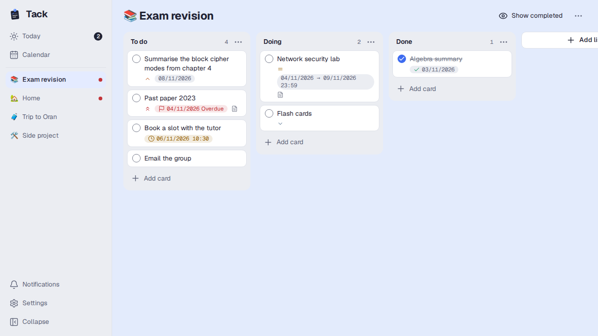
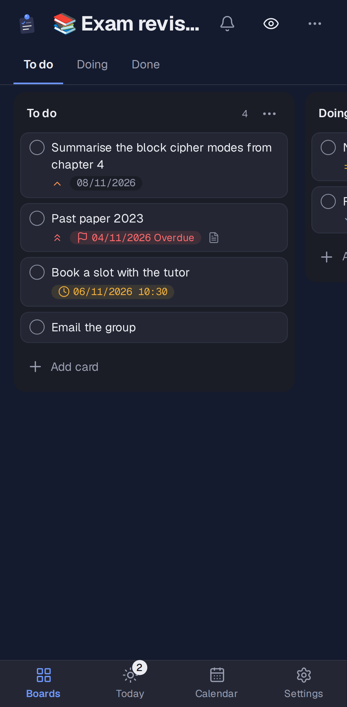
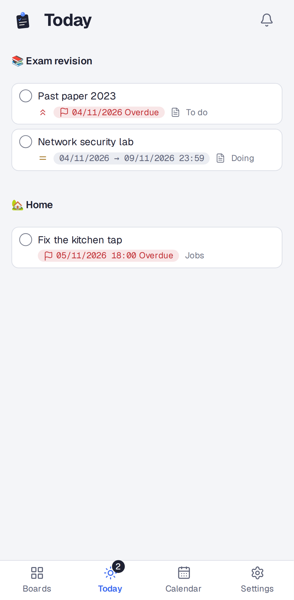

# Tack

A minimal, fast personal task board: boards, lists and cards, a Today view and a calendar. It
installs as an app on desktop and phone, works fully offline, syncs between devices within about a
second, and sends a push notification the day before a card is due. One user, self-hosted.



<p>
  
  
</p>

It runs as two containers on a home server and is reached through a Cloudflare tunnel:

- **tack-app**: Fastify API and the web app (PWA), SQLite in `./data/tack.db`.
- **tack-backup**: a daily snapshot to `./backups` and Google Drive via rclone, 30 days kept.

## Deploy

Needs Docker with Compose, and a user with uid 1000 (the app container runs as that user and writes
`./data` and `./backups`).

```sh
git clone git@github.com:lou-bou/tack.git
cd tack
make up              # creates .env from .env.example on the first run
```

Then generate the push keys on any machine with Node 24 and a checkout:

```sh
npm install
npm run vapid
```

Paste the output into `.env`, set `VAPID_SUBJECT=mailto:<your address>`, and run `make up` again.
Keep the keys: changing them stops notifications until each phone enables them again.

`make ps` should show `tack-app` as healthy, and this should print `{"ok":true}`:

```sh
curl 127.0.0.1:8097/api/health
```

To update later: `git pull && make up`. Open apps pick up the new version the next time you leave
them, or when you tap the **Update ready** pill.

### Settings (`.env`)

| Variable                | Default            | What it does                                                                       |
| ----------------------- | ------------------ | ---------------------------------------------------------------------------------- |
| `PORT`                  | `8097`             | Port the app listens on, inside and outside the container.                         |
| `BIND_ADDR`             | `127.0.0.1`        | Host address the port binds to. Keep it unless the tunnel runs on another machine. |
| `VAPID_PUBLIC_KEY`      |                    | Web Push key, from `npm run vapid`. Without keys everything but push works.        |
| `VAPID_PRIVATE_KEY`     |                    | The private half. Never commit it.                                                 |
| `VAPID_SUBJECT`         |                    | `mailto:` address that push services can contact.                                  |
| `TZ`                    | `Africa/Algiers`   | Time zone for the backup schedule. Dates in the app always use Africa/Algiers.     |
| `BACKUP_CRON`           | `30 3 * * *`       | When the daily backup runs (cron syntax, in `TZ`).                                 |
| `BACKUP_RETENTION_DAYS` | `30`               | Backups older than this are deleted locally and on Drive.                          |
| `RCLONE_REMOTE`         | `gdrive`           | rclone remote name.                                                                |
| `RCLONE_PATH`           | `tack-backups`     | Folder on that remote.                                                             |
| `RCLONE_CONFIG_DIR`     | `~/.config/rclone` | Folder holding `rclone.conf`.                                                      |

### Commands

```sh
make up              # build and start
make down            # stop
make logs            # follow logs
make ps              # status and health
make backup          # run a backup now
make backup-status   # the result of the last backup
make test-backup     # self-test backup, prune and restore on a throwaway database
make restore FILE=backups/tack-<stamp>.db.gz
```

## Cloudflare tunnel and Access

Tack has no login of its own: Cloudflare Access is the lock, so never publish the port directly.
Create the Access application **first**, so the hostname is never open.

1. In Zero Trust, go to **Access controls → Applications → Create new application → Self-hosted
   and private**, and add the public hostname (`tack` on your domain). Under **Access policies**,
   add a policy with Action **Allow** and an Include rule of **Emails** with your address. Enable
   **One-time PIN**, and pick a long **Session Duration**. Don't use "Everyone" or "Login Methods"
   as the Include rule: either lets anyone in.
2. Add the hostname to the tunnel.

   If your tunnel is managed from a config file, add this above the final catch-all rule in
   `config.yml`, then create the DNS record and restart:

   ```yaml
   ingress:
     - hostname: tack.example.com
       service: http://localhost:8097
     - service: http_status:404
   ```

   ```sh
   cloudflared tunnel route dns <tunnel-name> tack.example.com
   sudo systemctl restart cloudflared
   ```

   If it's managed from the dashboard, go to **Networking → Tunnels**, select the tunnel, then
   **Routes → Add route → Published application**, with **Service URL** `http://localhost:8097`.

3. Open the hostname in a private window. You should get the Cloudflare login first, then Tack.

To install on a phone, open it in the browser and use **Add to Home Screen** (iPhone) or **Install
app** (Android). iPhone only offers notifications to the installed app. Enable them under
**Settings → Notifications**.

When an Access session expires, the app keeps working on your device and shows a **Session expired
· Sign in** pill. Edits stay queued until you've signed in.

## Backups

Every day at `BACKUP_CRON` the backup container:

1. takes a consistent snapshot with SQLite's `.backup` (safe while the app is writing) and checks
   its integrity,
2. gzips it to `./backups/tack-<date>-<time>.db.gz`,
3. uploads it with `rclone copy` to `RCLONE_REMOTE:RCLONE_PATH`,
4. deletes backups older than `BACKUP_RETENTION_DAYS` in both places,
5. writes the outcome to `./backups/status.json`, which `make backup-status` shows.

### Google Drive (rclone) setup

Once per server. If a Drive remote already exists, reuse it: put its name in `RCLONE_REMOTE`.

```sh
sudo apt install rclone
rclone config
```

`n` (new remote) → name `gdrive` → storage `drive` → client id and secret blank → scope `1` (full
access) → root folder and service account blank → advanced config `n` → auto config `n` (the server
has no browser). Run the `rclone authorize "drive" "…"` command it prints on any computer with a
browser and rclone, sign in, and paste the token back. Shared drive `n`, then confirm.

Configure rclone as your normal user, not with sudo: the container runs as uid 1000 and reads the
config from `RCLONE_CONFIG_DIR`. Check with:

```sh
rclone lsd gdrive:
make test-backup     # ends with "All backup checks passed."
make backup          # ok tack-....db.gz -> /backups and gdrive:tack-backups
```

### Restore

```sh
ls backups/          # pick a file
make restore FILE=backups/tack-2026-11-02-033000.db.gz
```

`make restore` stops the app, checks the backup's integrity, keeps the current database as
`./data/before-restore-<stamp>.db`, puts the backup in place and starts the app again. A corrupt
file is refused without touching anything.

Devices notice the restore on their next sync and start over from the restored data. Anything newer
than the backup is gone from them too, except edits still waiting to be sent, which go out as usual.

From Google Drive, when the server or the local copies are lost:

```sh
rclone ls gdrive:tack-backups
rclone copy gdrive:tack-backups/tack-2026-11-02-033000.db.gz backups/
make restore FILE=backups/tack-2026-11-02-033000.db.gz
```

## Development

Needs Node 24.

```sh
npm install
npm run dev          # server on :8097, web with hot reload on :5173
```

```sh
npm run check        # types, lint, format, unit and sync tests, also under other time zones
npm run test:e2e     # builds, then runs Playwright at desktop and phone sizes
```

The end-to-end tests need Playwright's Chromium once: `npx playwright install chromium`. To check
speed on a heavy board, `node scripts/seed-perf.mjs <server url>` adds one with 10 lists and 200
cards.

### How it fits together

- `shared/`: types, schemas, date rules, Today and calendar selection, merge, positions and clocks.
- `server/`: Fastify, migrations, sync routes, the realtime stream, the notification scheduler, push
  and the Trash purge.
- `web/`: the React app, the device database and sync client, the service worker, and `themes/`,
  the only place raw colours and sizes are allowed.
- `backup/`: the backup image and scripts.
- `e2e/` and `tests/`: Playwright, and the randomized sync convergence and contrast tests.

Every edit lands in the device's database first, along with a queued change, and the UI only ever
reads from there. The sync engine pushes the queue and pulls what's new; the server decides conflicts
per field, last write wins, and tells other devices over Server-Sent Events. `SPEC.md` and
`DESIGN.md` say what it should be, and `PLAN.md` records how it was built and why.

## License

[MIT](LICENSE)
